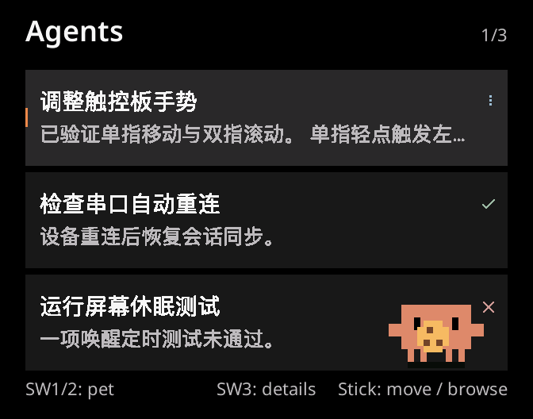
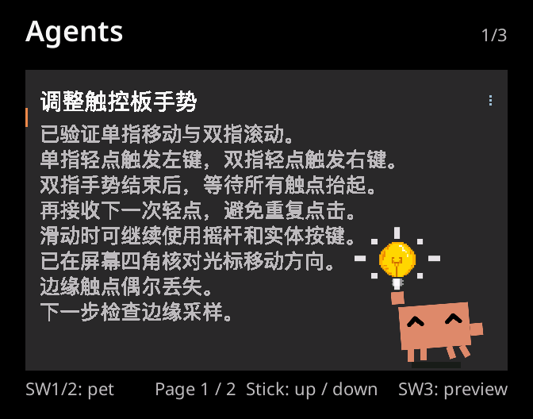
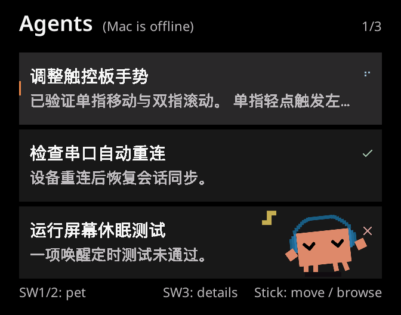
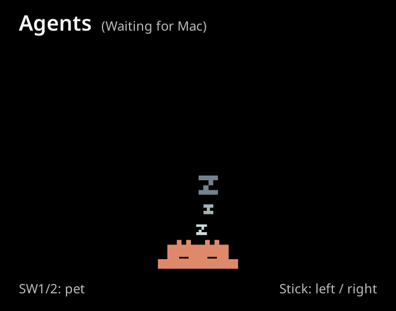
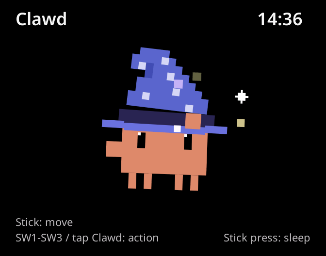
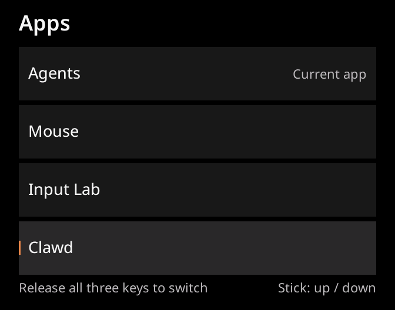
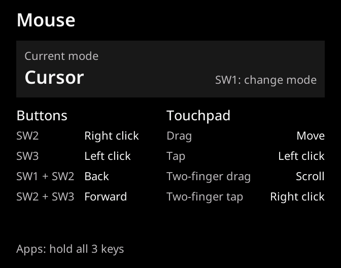
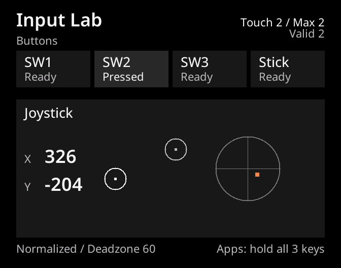

# ClawDock

ClawDock 是基于 HachimoDock 和 ESP32-P4 的实体桌宠。Clawd 会随编程会话状态改变动作，也能用摇杆、按键和触屏互动。设备可以查看 Codex、OpenCode、Claude Code 和 Pi 的本地会话，并提供鼠标和输入诊断功能。

## 应用界面

预览使用固件渲染器的原始配色，四周留白按文档展示调整。实机显示对 Clawd 的主体橙色做了屏幕补偿。会话内容和输入状态使用示例数据。

**Agents 会话列表与详情**

<p>
  <a href="docs/screenshots/sessions.png"></a>
  <a href="docs/screenshots/session-detail.png"></a>
</p>

**掉线与等待连接**

<p>
  <a href="docs/screenshots/sessions-offline.png"></a>
  <a href="docs/screenshots/sessions-waiting.png"></a>
</p>

**Clawd 桌宠与应用选择器**

<p>
  <a href="docs/screenshots/clawd.png"></a>
  <a href="docs/screenshots/app-picker.png"></a>
</p>

**鼠标与输入诊断**

<p>
  <a href="docs/screenshots/mouse.png"></a>
  <a href="docs/screenshots/input-lab.png"></a>
</p>

## 快速开始

运行 ClawDock 固件的设备开机进入 `Agents`。同时按住 SW1、SW2、SW3 打开应用选择器，用摇杆上下选择，松开三个键后切换应用。

通过 CH343 USB-UART 将设备连接到 Mac，在仓库根目录运行以下命令。菜单栏应用负责会话同步、鼠标桥接和 Clawd 校时。

```sh
host/start-mouse-bridge.sh
```

## 项目文档

- **设备固件** · 应用操作、原生 USB HID、构建、测试与恢复。[ESP32-P4 固件说明](firmware/README.md)
- **Mac 菜单栏应用** · 串口连接、辅助功能权限与会话来源配置。[macOS 应用说明](host/README.md)

## 实验记录

项目在一台 HachimoDock 设备上开发和验证。各篇记录列出测试条件、实机观察与待验证项目。

| 主题 | 记录 |
| --- | --- |
| 硬件与显示 | [硬件基线](experiments/2026-11-17-hardware-baseline.md) · [首次烧录](experiments/2026-11-17-input-firmware.md) · [屏幕与输入](experiments/2026-11-17-display-firmware.md) |
| 输入与切换 | [触控点数](experiments/2026-11-17-touch-limit.md) · [摇杆校准](experiments/2026-11-17-joystick-visualization.md) · [应用选择器](experiments/2026-11-17-app-switching.md) |
| 鼠标与 Mac | [USB 鼠标](experiments/2026-11-17-usb-mouse.md) · [触控板](experiments/2026-11-17-touchpad.md) · [Mac 菜单栏应用](experiments/2026-11-18-mac-menu-bar.md) |
| 会话与桌宠 | [Clawd 与会话监看验证](experiments/2026-11-18-clawd-sessions.md) |

## 参考项目

ClawDock 以 HachimoDock 为硬件起点，独立开发设备端应用和 Mac 桥接程序。屏幕驱动及面板初始化代码包含原项目的 Apache-2.0 组件。[HachimoDock](https://github.com/ai-maker-lab/HachimoDock) · [第三方代码与素材](firmware/README.md#第三方代码与素材)
