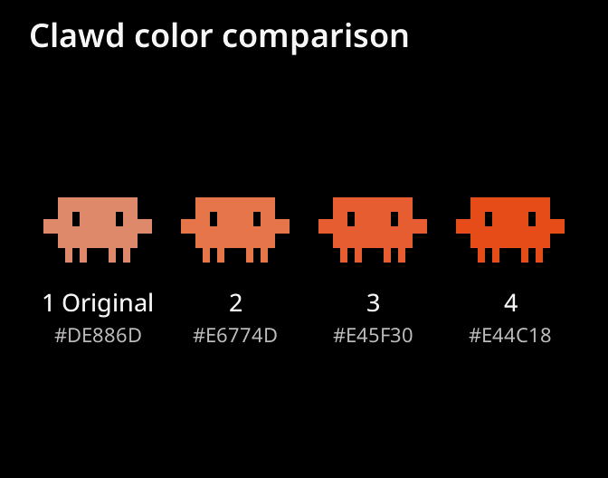

# 近台 ESP32-P4 固件

固件面向 ESP32-P4 v3，在 640×480 屏幕上提供会话监看、鼠标、输入诊断和 Clawd 桌宠。[界面预览](../README.md#应用界面)

## 应用切换

1. 设备开机进入 `SESSIONS`。同时按住 SW1、SW2、SW3 打开应用选择器。
2. 保持三个键按下，用摇杆上下选择。列表顺序为 `SESSIONS`、`MOUSE`、`INPUT LAB`、`CLAWD`，首尾循环。每次移动后先让摇杆回中。
3. 松开全部三个键，切换到所选应用。切换后抬起触点、释放按键并让摇杆回中，即可开始操作。选回当前应用会继续原状态。

三键并击识别窗口约 180 ms，从第一个 SW 键消抖后开始。确认三个键均按下时立即打开选择器，这次并击由选择器处理。未形成并击时，缓存的事件按顺序交给当前应用。选择器打开期间，应用输入和诊断输出暂停。

应用作为前台模块编入固件。输入采集、摇杆校准、显示与休眠由系统统一管理。换到其他应用时重置旧应用运行状态，Clawd 桌宠状态保留到本次开机结束。

## 设备应用

### 会话监看

通过 CH343 USB-UART 连接设备并运行 Mac 菜单栏应用。列表最多保留 6 个会话，每屏显示 3 条。运行中的会话优先，随后是近 60 秒内结束的会话。每条显示会话标题和最近回复的一行预览，右侧蓝色点阵、绿色勾、红色叉和灰色短横分别表示运行、完成、失败和取消。[Mac 应用与会话来源](../host/README.md#会话监看)

进入详情时，选中的卡片展开并占满列表区域。预览和详情共用标题布局、正文字号和首行间距。没有可见回复时，运行中的会话显示 `Waiting for a reply`，已结束的会话显示 `No reply available`。收到回复后，正文从同一位置开始显示。详情将最近一条可见回复按每页 8 行分页，最多显示 24 页。[列表和详情预览](../README.md#应用界面)

| 操作 | 功能 |
| --- | --- |
| 摇杆上下 | 在会话列表中循环浏览，在详情中翻页 |
| SW3 | 在列表预览和详情之间切换 |
| SW1、SW2 | 摸摸 Clawd，睡着时也能叫醒 |
| 摇杆左右 | 控制 Clawd，回中后恢复巡游 |

首次收到会话数据前，页头显示 `Sessions (Waiting for Mac)`。同步后超过 8 秒未收到会话数据，页头显示 `Sessions (Mac is offline)`。这时继续显示上次的会话列表、选中项和已显示的详情页，运行中的蓝色点阵停在掉线时的那一帧。收到有效新数据后更新画面，仍在运行的会话恢复动画。等待连接和掉线时也可以用按键和摇杆与 Clawd 互动。[掉线界面预览](../docs/screenshots/sessions-offline.png)

会话来源暂时不可用时，页头显示 `Sessions (Sources unavailable)`，已有列表也会保留。同步成功且列表为空时，Clawd 会到画面底部中央打盹。

Clawd 以桌宠页一半的尺寸在 Sessions 底部巡游，常态宽约 120 像素。它随机走约 1.8–3.6 秒，停下呼吸约 2–3.2 秒，有时会在停歇后掉头，到两端也会停歇。角色和道具可能遮住部分卡片内容。走路范围从左侧 32 px 页面边距到屏幕右侧，较宽的动作会在边缘向内调整。

会话进入运行、完成、失败或取消时各有偏好的随机动作。手动互动从全部 8 个动作中选取，与会话事件共享最近两次的动作记录。移动时按 SW1 或 SW2，摇杆回中后播放动作。表演结束后，有运行中的会话时 Clawd 会继续巡游，否则走到画面底部中央打盹。[会话与桌宠验证记录](../experiments/2026-11-18-clawd-sessions.md)

### 鼠标

| 操作 | 功能 |
| --- | --- |
| 摇杆 | 移动光标，持续推动会加速至上限，回中后重置加速 |
| SW1 | 切换光标和滚轮模式，滚轮模式支持纵向和横向滚动 |
| SW2 / SW3 | 右键 / 左键 |
| SW1 + SW2 / SW2 + SW3 | 鼠标 4（返回）/ 鼠标 5（前进） |
| 单指滑动 / 轻点 | 移动光标 / 左键，连续两次轻点可双击 |
| 双指滑动 / 轻点 | 滚动 / 右键，双指手势后需全部抬起才开始下一次手势 |

触摸可与摇杆和实体按键同时使用。单键短按在松开后发送，按住超过并击窗口时发送按下。窗口内确认双键时抑制各自的单键动作，三键优先打开选择器。单键或双键已经送出时，先松开所有 SW 键再开始下一次并击。切换应用或唤醒时会释放鼠标按键，重新进入鼠标应用时从光标模式开始。初次使用可将摇杆向四个方向推到边缘，帮助系统学习行程。

- **USB-UART 与 Mac** · 通过现有 CH343 路径连接，启动 Mac 菜单栏应用并授予辅助功能权限。桥接根据摇杆幅度产生连续像素滚动，固件与桥接程序需使用同版本。[启动和授权](../host/README.md)
- **原生 USB HID** · 与原项目使用相同切换电路的板卡可通过短接跳线，将共用的 Type-C 接口切至 USB HS OTG，作为五键鼠标使用。跳线断开时走 CH343，提供串口日志和会话监看。操作前核对实际板卡接线。原生 HID 枚举和其他系统的行为待实机验证，侧键与横向滚动的表现随系统和应用而异。[原项目接线说明](https://github.com/ai-maker-lab/HachimoDock/blob/9a22e0f/firmware/README.md)

USB-UART 路径上的光标、左右键、滚轮、浏览器前进后退与触控板手势已有实机记录。[USB 鼠标](../experiments/2026-11-17-usb-mouse.md) · [触控板实验](../experiments/2026-11-17-touchpad.md)

### 输入诊断

- **按键** · SW1、SW2、SW3 和摇杆中键以低电平表示按下，约每 20 ms 采样一次，连续 3 次读数相同后报告状态变化。画面显示物理按键状态，短于消抖时间的操作可能被漏采。
- **摇杆** · 启动时松开摇杆，让系统学习稳定中心。启动后沿边缘转一两圈，学习各方向行程。屏幕按 ±60 ADC 死区和逐方向行程换算显示范围 −1000 至 1000 的数值。初始行程不足 500 ADC 时用临时分母，首圈示意点可能越过等比例参考圆。重启后重新校准。诊断期间串口约每秒输出未经死区处理的 ADC 窗口最小值、最大值和读取错误数。[摇杆校准实验](../experiments/2026-11-17-joystick-visualization.md)
- **触控** · 约每 20 ms 从 CST826 的 I2C 地址 `0x38`、寄存器 `0x02` 开始读取 13 个字节。屏幕显示报告点数 `Touch`、有效坐标数 `Valid` 和本次进入诊断台以来的最大报告点数 `Max`。最多解析和绘制两个坐标，更高的报告点数仍显示。诊断期间，触点计数变化与持续触摸会输出原始报告和有效坐标。双帧缓冲界面约每 100 ms 更新一次，实际间隔取决于任务调度和 I2C 响应。[触控实验](../experiments/2026-11-17-touch-limit.md) · [CST826 数据手册](https://surenoo.tech/download/04_STP/Controller/CST826.pdf)

在采用同一接线的板卡上，SW1、SW2、SW3、摇杆中键分别是 GPIO50、GPIO49、GPIO5、GPIO4，摇杆 X/Y 分别是 GPIO21/GPIO20。[原项目输入驱动](https://github.com/ai-maker-lab/HachimoDock/blob/9a22e0f/firmware/main/pet_p4_input.c)

### Clawd 桌宠

摇杆四向控制走路，中键切换睡觉和起床。按任意一个 SW 键或点 Clawd，会从 8 个趣味动作中随机挑选。约每 30 秒也会自动挑一次，三种触发方式共用最近两次的动作记录。走路或表演时，自动动作等到空闲才播放。睡觉时跳过自动动作，醒来后重新计时。

右上角显示 24 小时制本地时间。Mac 菜单栏应用通过串口校时，设备同步后继续计时，重启后重新请求。首次校时前显示 `--:--`。[桌宠与校时验证记录](../experiments/2026-11-18-clawd-sessions.md)

## 屏幕休眠

所有应用共用休眠计时。连续 29 分钟无输入时显示 `Zzz...`，满 30 分钟关闭背光、让面板休眠并暂停绘制，设备和输入采样继续运行。实体按键改变状态、移动摇杆或触点变化会重置计时。按键持续按住、摇杆或触点停在原位，以及会话更新时，计时继续。

休眠后的首次输入用于唤醒。随后释放按键和触点、让摇杆回中，再进行应用操作。

## 构建

需要 Python 3.10+ 和 PlatformIO Core 6.1.19，首次构建需要联网下载 ESP-IDF 和工具链。在仓库根目录运行：

```sh
python3 -m venv .venv
.venv/bin/python -m pip install platformio==6.1.19
.venv/bin/pio run -d firmware
```

应用镜像位于 `firmware/.pio/build/p4_v3/firmware.bin`。构建脚本检查目标芯片版本，为镜像标注 v3.0–v3.99，并移除 PlatformIO 自动生成的完整合并镜像。已用 ESP-IDF 5.5.4 完成构建。内存统计阶段有过 `cannot assign memory region sram_seg to chip memory type` 告警，应用镜像仍成功生成。[构建与启动记录](../experiments/2026-11-17-usb-mouse.md)

## 实机运行与恢复

烧录前核对板型、当前分区及恢复路径，并备份需要保留的设备数据。独立固件的默认分区布局可能与原设备不同，整套烧录或改写分区表可能覆盖设备数据。原项目固件的完整恢复待实机验证，R206 各板型的恢复包见原项目发布页。[HachimoDock v0.1.217](https://github.com/ai-maker-lab/HachimoDock/releases/tag/v0.1.217)

通过 USB-UART 以 115200 baud 查看近台日志，启动信息包括芯片修订号和可用堆内存。输入数据可在 `INPUT LAB` 查看。Mac 菜单栏应用运行时会占用串口，烧录或打开串口监视器前先从菜单退出。固件运行时未初始化音频或 Wi-Fi，也未读写应用数据分区。[独立固件首次烧录](../experiments/2026-11-17-input-firmware.md)

## 主机测试

以下命令在仓库根目录运行，覆盖应用切换、休眠、会话 Clawd、鼠标并击、触控板、摇杆与触控报告。

```sh
cc -std=c11 -Wall -Wextra -Werror -Ifirmware/main firmware/tests/app_manager_test.c firmware/main/app_manager.c firmware/main/app_runtime.c firmware/main/mouse.c firmware/main/clawd.c -o /tmp/jintai-app-manager-test
/tmp/jintai-app-manager-test

cc -std=c11 -Wall -Wextra -Werror -Ifirmware/main firmware/tests/screen_idle_test.c firmware/main/screen_idle.c -o /tmp/jintai-screen-idle-test
/tmp/jintai-screen-idle-test

cc -std=c11 -Wall -Wextra -Werror -Ifirmware/main firmware/tests/sessions_clawd_test.c firmware/main/sessions_clawd.c firmware/main/clawd.c -o /tmp/jintai-sessions-clawd-test
/tmp/jintai-sessions-clawd-test

cc -std=c11 -Wall -Wextra -Werror -Ifirmware/main firmware/tests/mouse_test.c firmware/main/app_manager.c firmware/main/app_runtime.c firmware/main/mouse.c firmware/main/clawd.c -o /tmp/jintai-mouse-test
/tmp/jintai-mouse-test

cc -std=c11 -Wall -Wextra -Werror -Ifirmware/main firmware/tests/touchpad_test.c firmware/main/touchpad.c -o /tmp/jintai-touchpad-test
/tmp/jintai-touchpad-test

cc -std=c11 -Wall -Wextra -Werror -Ifirmware/main firmware/tests/joystick_test.c firmware/main/joystick.c -o /tmp/jintai-joystick-test
/tmp/jintai-joystick-test

cc -std=c11 -Wall -Wextra -Werror -Ifirmware/main firmware/tests/touch_format_test.c firmware/main/touch_format.c -o /tmp/jintai-touch-format-test
/tmp/jintai-touch-format-test
```

## 设备界面与素材构建

设备画布为纯黑，面板和正文采用灰阶，橙色用于小面积交互反馈。左侧 32 px 页面边距抵消设备两侧硬件黑边的宽度差。应用选择器和会话列表共用焦点行，各页面共用标题和操作提示。固件英文标签使用嵌入的 Noto Sans 22、27、36 px 抗锯齿字形，会话标题和回复由 Mac 渲染。[界面样式定义](main/app_ui_theme.h)

Clawd 帧按设备显示尺寸生成，常态角色宽约 240 px，采用共用脚底锚点、4 位透明度和逐帧压缩。Sessions 中以一半尺寸绘制。常规构建直接使用预生成的字形和动画数据。更新时用 Pillow 11.3.0 生成字形，动画另需 Playwright 1.59.0。在仓库根目录运行：

```sh
python3 firmware/scripts/build_ui_font.py /path/to/NotoSans.ttf firmware/main/app_ui_font.bin

python3 -m playwright install chromium
python3 firmware/scripts/build_clawd_frames.py
```

### Clawd 屏幕颜色对比

屏幕测试在固定背光和姿势下对比四种主体橙色。1 号 `#DE886D` 用于主 README 的预览，2 号 `#E6774D` 用于实机。3 号和 4 号展示更高的饱和度。



## 第三方代码与素材

- **ST7701** · MIPI 驱动与面板初始化包含 HachimoDock 的 Apache-2.0 组件。[驱动来源](components/st7701/NOTICE.md) · [许可证](components/st7701/LICENSE)
- **Noto Sans** · 固件中的预生成字形。[源字体](https://github.com/google/fonts/blob/7af0d90b4d532ffa4b041937b560c6df4e7b1e95/ofl/notosans/NotoSans%5Bwdth%2Cwght%5D.ttf) · [SIL OFL 1.1](main/app_ui_font.OFL.txt)
- **Clawd** · Anthropic 的 Claude Code 吉祥物。动画 SVG 主要来自 Clawd Tank，近台调整了开心跳的幅度并增加了吃饼干动画。[上游动画素材](https://github.com/marciogranzotto/clawd-tank/tree/ee5c079c45a39e06e79b7a39f3e6d9beca223021/assets/svg-animations) · [MIT 许可](assets/clawd/LICENSE)
